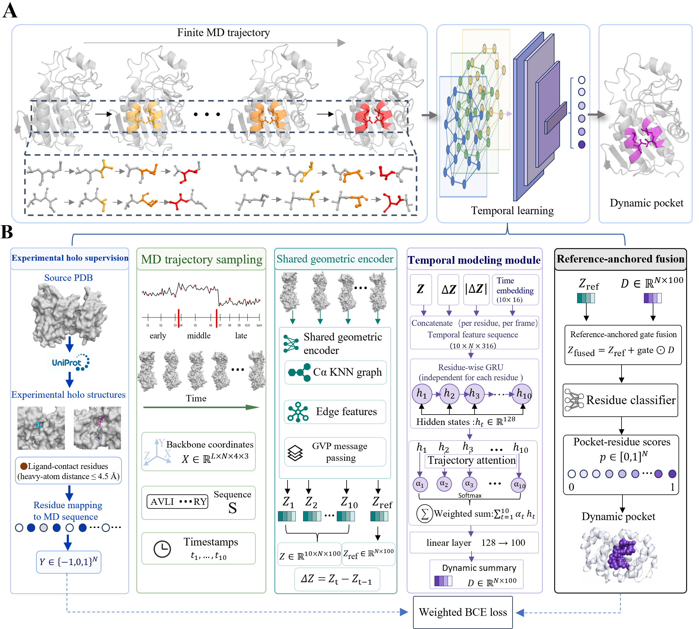

# PreDyPocket

**PreDyPocket (Predicting Pockets from Dynamics)** is a trajectory-informed model for
residue-level cryptic-site prediction. It integrates temporally ordered conformations
from short molecular dynamics (MD) trajectories into residue-level scores, which are
spatially grouped into dynamic pockets. PreDyPocket builds the dynamic layer of
[CpuPDB](https://www.cpupdb.com), a conformational pocket-universe database.

> Tang, K.; Zhang, X.; Duan, Z.; Lui, D.; Li, H.; Zhu, W.; Zeng, L.; Hu, C.; Liao, J.
> CpuPDB: A Conformational Pocket-Universe Database Integrating Experimental, Dynamic
> and Predicted Binding-Site Evidence. *J. Chem. Inf. Model.* (in revision).



## Contents

- [Overview](#overview)
- [Repository layout](#repository-layout)
- [Installation](#installation)
- [Quick start](#quick-start)
- [Input data](#input-data)
- [Residue labels](#residue-labels)
- [Inference](#inference)
- [Training](#training)
- [Parameter files](#parameter-files)
- [Reproducing the paper](#reproducing-the-paper)
- [Paper data](#paper-data)
- [Citation, license and acknowledgements](#citation-license-and-acknowledgements)

## Overview

For each MD trajectory, PreDyPocket

1. divides the trajectory chronologically into early, middle and late segments (3:3:4)
   and selects 3, 3 and 4 representative conformations by per-segment clustering,
   giving ten time-ordered frames; the final frame is the reference conformation;
2. encodes every frame and the reference with a GVP-GNN encoder pretrained in
   PocketMiner and kept frozen (100-dimensional residue embeddings);
3. builds transition features from each frame embedding, the change from the previous
   frame, its magnitude and a time embedding, and projects them to 128 dimensions;
4. models each residue's ordered representations with a GRU and summarizes them with
   trajectory attention (128-dimensional dynamic summary);
5. projects the summary to 100 dimensions and adds it to the reference embedding
   through a learnable gate;
6. scores every residue with a residue classifier.

Residues with scores ≥ 0.6 are clustered into dynamic pockets (Cα distance ≤ 8 Å,
at least four residues). Equation numbers in the manuscript Methods (eqs 1–12) follow
the same order.

## Repository layout

```text
.
├── configs/                 # parameter files (YAML)
│   ├── train.yaml           #   training settings reported in the paper
│   ├── predict.yaml         #   inference
│   ├── evaluate_pm39.yaml   #   PM39 benchmark evaluation
│   └── toy/                 #   smoke test on the bundled example
├── src/
│   ├── sample_predypocket_frames.py   # 3:3:4 representative-frame sampling
│   ├── prepare_predypocket_data.py    # residue labels
│   ├── train_predypocket.py           # training
│   ├── predypocket_predict.py         # inference and dynamic-pocket clustering
│   ├── evaluate_pm39.py               # residue-level PM39 evaluation
│   ├── predypocket_pocketminer_model.py, models.py, gvp.py   # model
│   └── predypocket_utils.py, util.py, config.py              # utilities
├── weights/                 # trained PreDyPocket checkpoint
├── scripts/download_pocketminer_weights.sh   # pretrained encoder for training
├── examples/dynamic_data_example/            # synthetic toy system
├── paper_data/              # data files referenced in the paper
├── docs/                    # architecture figure
└── tests/                   # unit tests
```

## Installation

Tested with Python 3.9, TensorFlow 2.9.1, MDTraj 1.10.1, NumPy 1.23.5, SciPy 1.13.1
and PyYAML 6.0 on Linux and Windows. Inference runs on CPU; training on GPU is recommended.

```bash
git clone https://github.com/KiKi-Porter/predypocket-model.git
cd predypocket-model
conda env create -f environment.yml
conda activate predypocket
```

or, in an existing Python 3.9 environment, `pip install -r requirements.txt`.
For GPU training, install a TensorFlow build that matches your CUDA driver.

All commands below are run from the repository root with `src` on the Python path:

```bash
export PYTHONPATH=src          # Windows PowerShell: $env:PYTHONPATH="src"
python -m unittest discover -s tests
```

## Quick start

The bundled toy system runs in about a minute and needs no network access.

```bash
# 1. sample the ten 3:3:4 representative frames
python src/sample_predypocket_frames.py --system-dir examples/dynamic_data_example/TOY/TOY_TOY_1.LIG_B_101 --out-prefix outputs/toy_sample

# 2. predict residue scores and dynamic pockets with the bundled model
python src/predypocket_predict.py --config configs/predict.yaml --system-dir examples/dynamic_data_example/TOY/TOY_TOY_1.LIG_B_101 --out-prefix outputs/toy_inference/toy
```

## Input data

Each MD system is a directory under `dynamic_data/<entry_id>/<system_id>/`. The entry
ID (usually the PDB ID) is used to assign systems to the data partitions.

```text
dynamic_data/
└── 4KVK/
    └── 4KVK_4KVK_1.PG4_A_703/   # <entry>_<entry>_<n>.<ligand>_<chain>_<resseq>
        ├── md_dry.nc            # trajectory
        ├── protein.prmtop       # topology
        ├── complex.prmtop       # complex topology   } used to locate the
        ├── complex.inpcrd       # complex coordinates} resident ligand
        └── complex_reference.pdb
```

Trajectories are read with MDTraj (`.nc`, `.xtc`, `.dcd`, `.trr`, `.h5`, multi-model
`.pdb`); binary formats require a matching topology. For inference only the trajectory
and topology are needed. The processed CpuPDB trajectories are available at
<https://zenodo.org/api/records/15713880/files/MD.h5/content>.

## Residue labels

Labels are built from experimentally observed ligand-contact sites and are used only as training targets; they are never model inputs.

| Label | Class | Definition | Loss and AUROC/AUPRC |
|:---:|---|---|---|
| 1 | positive | residue mapped from a ligand-contact site (heavy-atom distance ≤ 4.5 Å) in a homologous protein–ligand structure from the RCSB PDB (sequence identity ≥ 70%, query coverage ≥ 80%, up to five structures) | included |
| 0 | negative | any other mapped residue | included |
| −1 | masked | residue within 4.5 Å of the ligand retained in the simulated complex (resident ligand), unmapped residue, or residue meeting both the resident-contact and homolog criteria | excluded |

Labels are written to `<out_dir>/labels/paper/<sample_id>.npy`. RCSB search results and
downloaded structures are cached in `<out_dir>/rcsb_cache`, so repeated runs are offline.

## Inference

```bash
python src/predypocket_predict.py --config configs/predict.yaml --system-dir dynamic_data/4KVK/4KVK_4KVK_1.PG4_A_703 --out-prefix outputs/4KVK
```

To point at files directly, replace `--system-dir` with
`--trajectory traj.xtc --topology top.pdb`.

| Output | Content |
|---|---|
| `<prefix>_scores.csv` | `residue_index`, `residue_key` (chain:resseq:icode:resname), `aa`, `score`, `selected_frames`, `reference_frame` |
| `<prefix>_pockets.csv` | `pocket_id`, `n_residues`, `mean_score`, `max_score`, `residue_indices`, `residue_keys` |
| `<prefix>_scores.npy` | residue scores |
| `<prefix>_selected_frames.npy` | indices of the ten selected frames |
| `<prefix>_residue_keys.npy` | residue identifiers |

Scores are residue-level model outputs, not calibrated binding probabilities.

## Training

**1. Download the pretrained encoder** (PocketMiner; used for initialization only)

```bash
bash scripts/download_pocketminer_weights.sh
```

**2. Train**

```bash
python src/train_predypocket.py --config configs/train.yaml
```

Systems are assigned to the family-disjoint partitions in `paper_data/splits`
(train 5,206; validation 651; test 651). Only the temporal modules, the projection,
the gated fusion and the residue classifier are optimized; the GVP-GNN encoder stays
frozen. A checkpoint is saved after every epoch in `runs/predypocket/`, together with
`history.csv` (training loss and validation loss, AUROC and AUPRC), `best_epoch.txt`,
`training_config.json` and `test_metrics.json`.

Multi-GPU training: set `CUDA_VISIBLE_DEVICES` and add `--manual-gpu-replicas`
(`batch_size` must be divisible by the number of GPUs). If very large proteins exceed
GPU memory, `--max-residues N` skips systems with more than N residues.

## Parameter files

Every command accepts `--config file.yaml`. Keys are the long option names written with
underscores; any option given on the command line overrides the file:

```bash
python src/train_predypocket.py --config configs/train.yaml --epochs 20 --out-dir runs/test
```

| `configs/train.yaml` | Value |
|---|---|
| optimizer / learning rate | Adam / 1 × 10⁻⁴ |
| epochs / batch size | 10 / 4 |
| temporal dimension / dropout | 128 / 0.1 |
| encoder | frozen (`freeze_backbone: true`) |
| partitions | `paper_data/splits` |

| `configs/predict.yaml` | Value |
|---|---|
| residue-score cutoff / Cα distance / minimum residues | 0.6 / 8 Å / 4 |

## Reproducing the paper

**Data partitions.** `paper_data/splits/{train,val,test}.txt` list the entry IDs of the
6,508 MD systems; no protein family is shared between partitions. `configs/train.yaml`
uses these files and the training settings reported in the paper.

**PM39 benchmark.** `paper_data/pm39/` contains the cleaned PocketMiner benchmark used for
Table 1; metrics in the paper are pooled over all 55 structures. Six entries overlapping with model-development data were removed (1Y1A and 1HCL,
PreDyPocket training data; 1BTP, 1TVA, 4V38 and 4W51, CryptoBank PLM training set),
leaving 55 apo structures:

| Split | Structures | Cryptic-pocket structures | Negative controls | Evaluated residues (positive / negative) |
|---|---:|---:|---:|---:|
| validation | 23 | 19 | 4 | 713 (412 / 301) |
| test | 32 | 22 | 10 | 1,677 (505 / 1,172) |
| all | 55 | 41 | 14 | 2,390 (917 / 1,473) |

| File | Content |
|---|---|
| `manifests/pm39_cases.csv` | one row per structure: case ID, validation/test split, case type, chains, residue range and label counts |
| `manifests/pm39_residue_labels.csv` | residue labels (1, cryptic-pocket residue; 0, negative; 2, not evaluated) and the `is_eval_residue` flag |
| `manifests/pm39_summary.csv` | structures and evaluated residues per split |
| `md_inputs/` | starting structures for the MD simulations (`protein_only/` without non-protein atoms); `positive_cases/` and `negative_controls/` are subsets of `all/` |

Evaluate the PM39 predictions:

```bash
python src/evaluate_pm39.py --config configs/evaluate_pm39.yaml
```

## Paper data

| File | Content | Paper |
|---|---|---|
| `paper_data/splits/train.txt`, `val.txt`, `test.txt` | family-disjoint partitions of the 6,508 MD systems | Methods; Table S3 |
| `paper_data/pm39/` | cleaned PM39 benchmark: case list, residue labels and MD starting structures | Table 1; Table S4 |
| `paper_data/prioritized_candidate_pdb_ids.txt` | PDB IDs of the 124 prioritized candidate pockets; the corresponding records can be searched and downloaded at <https://www.cpupdb.com> | Figure 3; Section S7 |
| `paper_data/docking/docking_scores.txt` | docking results of the ten query systems: native crystal-coordinate score, native-redocking score, redocking RMSD, 20 retrieved and 3 random-control receptors | Figure 4; Figure S5; Section S8 |
| `paper_data/docking/docking_scores.csv` | the same scores in long format (`query`, `group`, `receptor`, `best_docking_score_kcal_mol`) | Figure 4; Figure S5; Section S8 |
| `paper_data/docking/native_references.csv` | native crystal-coordinate score, native-redocking score and RMSD per query | Section S8.2 |
| `paper_data/docking/redocking-native.xlsx` | source spreadsheet of the docking results | Figure 4; Figure S5; Section S8 |

## Citation, license and acknowledgements

If you use PreDyPocket or CpuPDB, please cite the paper above. The code is released under
the MIT License. PreDyPocket reuses the GVP-GNN encoder of PocketMiner
(Meller *et al.*, *Nat. Commun.* 2023, 14, 1177). MD trajectories include systems from MISATO
(Siebenmorgen *et al.*, *Nat. Comput. Sci.* 2024, 4, 367–378).

This software is intended for research use and is not a clinical or diagnostic tool.
